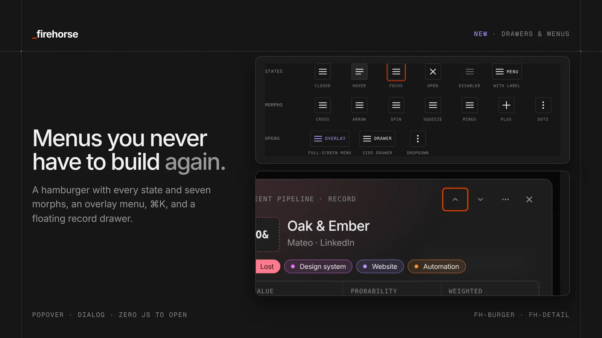
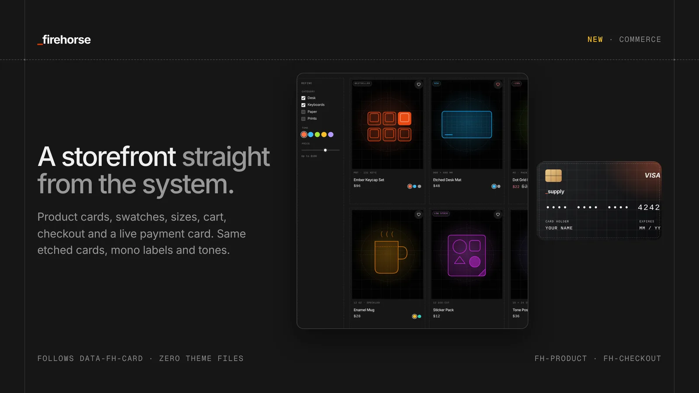
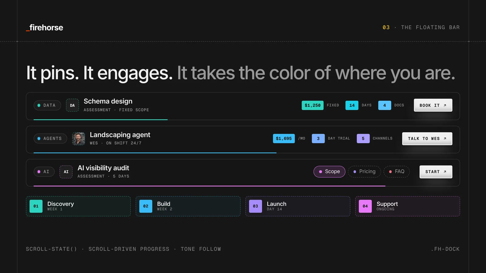
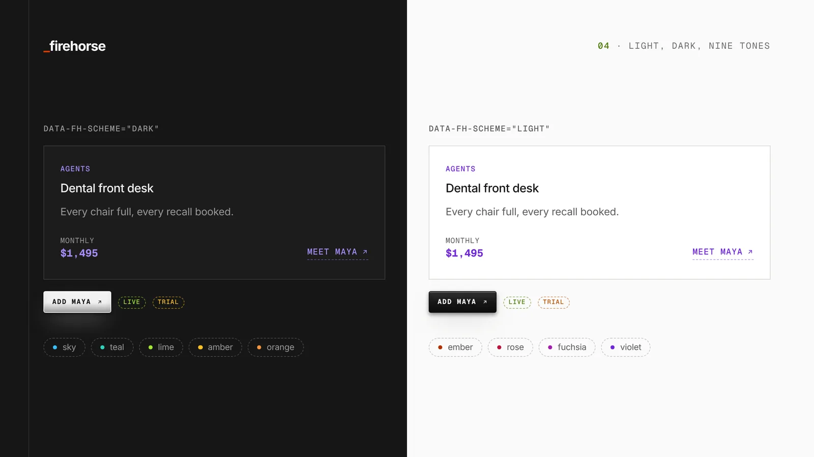
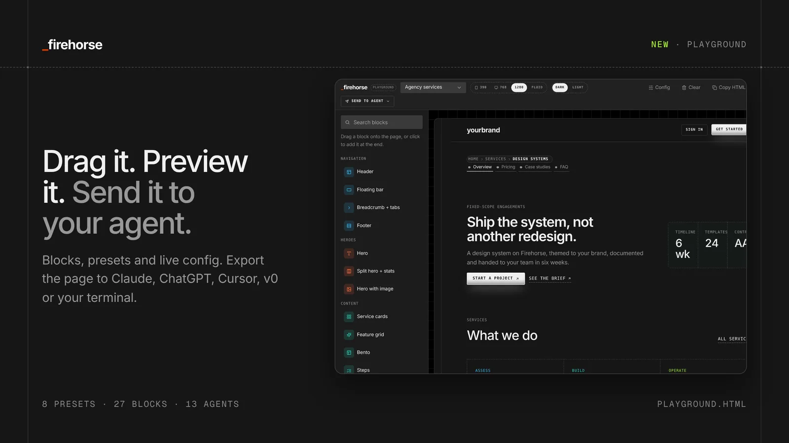
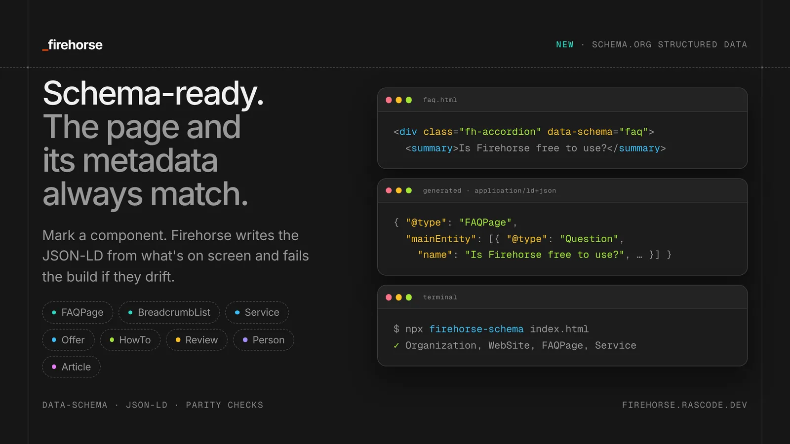
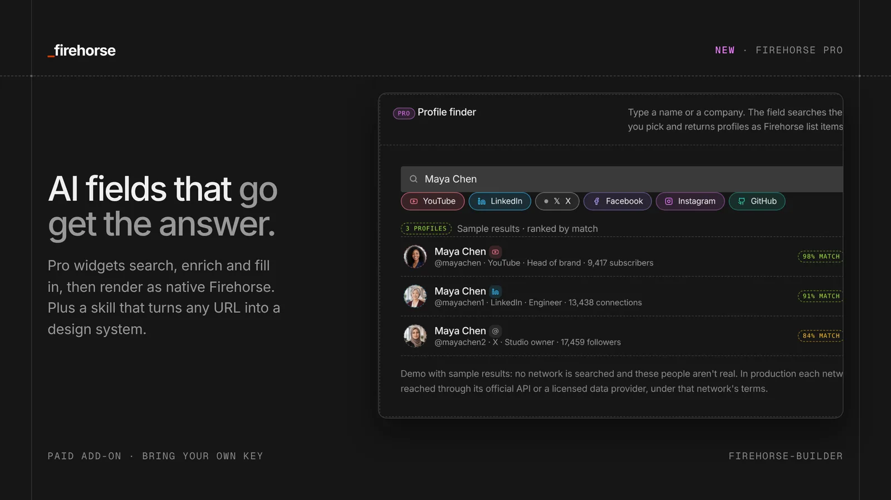
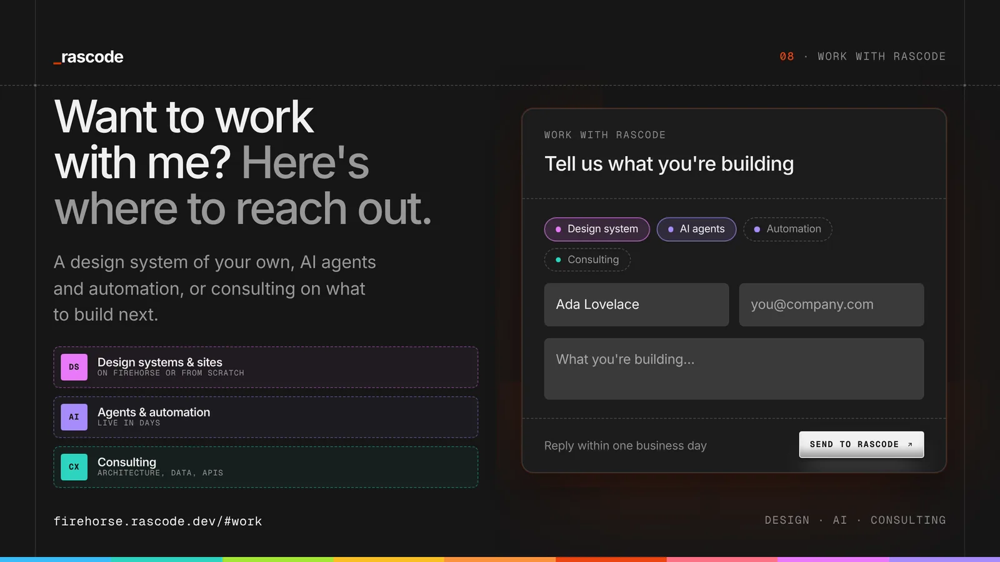

Every site we ship at [Rascode](https://rascode.dev) now runs on one system.

Today we're open-sourcing it.

[Firehorse](/) is a CSS-first design system: [220+ tokens](/#tokens), [100+ components](/#components), [8 cascade layers](/#principles), [light and dark built in](/#theming), and [zero viewport breakpoints](/#layout). It's [MIT licensed](https://github.com/rascode/firehorse/blob/main/LICENSE), needs no JavaScript to work, comes with [files an AI agent can read](/#agents) before it writes a single line of your UI, and generates [Schema.org structured data](/#schema) straight from your markup.

**TL;DR**
- Built on one principle: don't make me think. For people and for machines
- [One stylesheet](/firehorse.css), zero required JavaScript
- Components respond to [their container, not the screen](/#lab)
- [Text colors computed from the background](/#adaptive) with math, so contrast holds on any surface
- [Global configuration](/#config): pick your avatar shape, card style or button once, and it cascades everywhere
- [Datatables](/#data) with 22 field types, filters, sorting, grouping and board views
- [Drawers, hamburger menus and ⌘K](/#menus), [a full commerce kit](/#commerce), [183 icons](/#icons) and a [card catalog](/#catalog)
- A [drag-and-drop playground](/playground.html) that sends your page to Claude, ChatGPT, Cursor and more
- [The Firehorse Index](/#c-index): every component and variant has an ID, so you say `CHP-03` instead of describing a chip, and [KC](/agent/kc.md) turns your description into the ID
- [llms.txt](/llms.txt), an [agent contract](/agent/system.md) and [Schema.org JSON-LD](/#schema) generated from your markup
- [Firehorse Pro](/#pro): AI-powered fields, and a skill that builds a design system from any URL
- `npm i @rascode/firehorse` · [firehorse.rascode.dev](/)
- Want it built for you? [Work with me](/#services)

## Don't make me think

In 2000, Steve Krug published a short, funny book about web usability called [Don't Make Me Think](https://en.wikipedia.org/wiki/Don%27t_Make_Me_Think). Its first law fits on a sticky note: a page should be obvious. If someone has to stop and work out what something is, where to click, or whether a thing is a button, the page has already cost them something.

Krug's core observation was that people don't read web pages. They scan, pick the first reasonable option, and muddle through. So good design isn't about adding more. It's about removing the questions.

The book has had three editions: the original in 2000, a second in 2005, and [Don't Make Me Think, Revisited](https://www.pearson.com/en-us/subject-catalog/p/don-t-make-me-think-revisited-a-common-sense-approach-to-web-usability/P200000000385/9780133597264) at the end of 2013 (it carries a 2014 date), which added mobile. It has sold more than 700,000 copies. It's taught in usability and UX courses, handed to new designers and developers on day one, and quoted in more design reviews than anyone could count. Its ideas, like conventions over cleverness, clear visual hierarchy and cheap, frequent usability testing, are now just how the industry talks.

It's also the reason Firehorse exists.

We decided to build a design system because we wanted every Rascode page to pass Krug's test without anyone having to think about it. That starts with [beautiful grids and layout](/#layout): a frame and slot grid, consistent rhythm, and [type](/#foundations) that makes the hierarchy obvious before you read a word. When the structure is right, the page explains itself.

And in 2026 there's a second reader. AI agents build pages, and they read them too. They have the same problem people do, only worse: anything ambiguous becomes a guess. So Firehorse applies Krug's principle to machines as well. Components have [names an agent can use](/agent/components.md), the [rules are written down](/agent/system.md), and the [structured data](/#schema) says exactly what each part of the page is. Don't make the reader think. Don't make the agent think, either.

## Rules that free you up

There's a fear that a design system will flatten your style. That every site built on one will look the same.

From where we sit at Rascode, it works the other way. A design system doesn't limit your style. It enhances it.

Rules force a kind of precision thinking. When spacing comes from a [scale](/#tokens) and color comes from [roles](/#theming), every choice has to mean something. That discipline is what makes a design feel considered instead of assembled.

And the rules are the floor, not the ceiling. You can [theme it](/#theming), [reconfigure it](/#config), repaint a whole section [with one attribute](/#adaptive), and build custom sections and services that fit your aesthetic, or the aesthetic of the project in front of you. On the Firehorse site, the [store](/#commerce), the [datatable](/#data) and the [docs](/#components) all do very different jobs. One set of rules holds them together.

You're not locked in. You're freed up.

## Best in class, for everyone

Our aim is simple: a best-in-class design system that works just as well for the agent writing the code, the company shipping the product, the developer maintaining it, and the person who's never written CSS in their life.

- **Agents** get [llms.txt](/llms.txt), a short [rulebook](/agent/system.md) and exact markup
- **Companies** get [one source of truth](/#tokens) for brand, accessibility and [structured data](/#schema)
- **Developers** get native HTML, [cascade layers](/#principles), a lint step and tests
- **Everyone else** gets a [playground](/playground.html) to drag a page together and a [settings drawer](/#config) to restyle it, with no code

## Why we built it

We audited our own site first. It wasn't pretty.

The old [rascode.dev](https://rascode.dev) stylesheet was 425 KB. It had 481 hard-coded colors (51 distinct ones), 83 different font sizes, 30+ breakpoints, and 15 variables that were referenced but never defined.

Nothing was broken, exactly. But every new page was a negotiation with the last one.

So we pulled out everything the site actually uses: the [tokens](/#foundations), the [type](/#foundations), the [cards](/#c-card), the [dashed etched grids](/#layout), the [floating bar](/#c-dock). Then we rebuilt it as a system with rules.

## The principles

**[Container-native.](/#layout)** No component asks how wide the screen is. It asks how wide its own box is.

**[Layered.](/#principles)** Eight cascade layers, in a fixed order: reset, tokens, base, layout, components, patterns, themes, utilities. Your overrides win without `!important`. Ever.

**[Tokens all the way down.](/#tokens)** Components never touch raw hex values or primitives. A [lint step](https://github.com/rascode/firehorse/blob/main/scripts/lint.mjs) enforces it, so the rule survives contributors.

**Native first.** [Popover](/#c-overlay), [dialog](/#c-overlay), [`details` accordions](/#c-accordion), [scroll-snap carousels](/#c-carousel), scroll-driven animation, `@starting-style`. The platform does the work; the JavaScript is optional polish.

**[Accessible by default.](/#c-form)** Every text and tone pair is [contrast-checked](https://github.com/rascode/firehorse/blob/main/scripts/verify.mjs) in both schemes as part of `npm test`. Focus rings, reduced motion, forced colors and print are handled in the base layer.

## Container queries, baked in

This is the part we're proudest of.

Mobile-friendly usually means a pile of media queries guessing at screen sizes. Firehorse doesn't have any.

Every page section is a container. Every component inside it measures the slot it was dropped into. A [stats block](/#c-stats) in a 270px sidebar stacks. The same markup in a 780px column lays out in a row. A [card](/#c-card) in a narrow slot goes compact. The header collapses when its frame gets tight, not when the phone does.

Type scales with `cqi` units, so headlines grow with their container, too.

You write the markup once. It adapts everywhere you put it. Drag the width in the [container lab](/#lab) and watch it happen.

## Adaptive color: text that reads its background

Here's a problem every design system has. You put text on a cream card, and it needs to be dark. You put the same text on a navy band, and it needs to be light. Most systems handle this with a second set of classes, a JavaScript contrast check, or someone eyeballing it.

Firehorse uses math.

Every surface declares its background color. Every text token, from body copy to muted labels, placeholders, links and all nine tones, is computed from that background with CSS relative color formulas. A step function reads the background's lightness and flips to the right side of the contrast line. Muted text is offset from it by a measured amount. Tones keep their hue and move their lightness to stay readable.

Put `data-fh-surface` on any element, or set `--fh-color-bg` to any color you like, and everything inside it recolors itself. [Pick a color on the site](/#adaptive) and watch the contrast numbers update live.

We don't take the math on faith. A [test renders 432 text and background pairs](https://github.com/rascode/firehorse/blob/main/scripts/verify-adaptive.mjs) across 18 surfaces in a real browser and checks every one against WCAG AA. It's also why the light theme got its contrast pass in this release.

Always adaptive. Always thinking. No JavaScript required.

## Global configuration: decide once

How round are your avatars? Are your cards outlined, solid, elevated or glass? Are buttons pills or sharp?

In most systems, those decisions live in every component you write. Change your mind and you're editing a hundred files.

In Firehorse, you decide once, on the `<html>` element:

`<html data-fh-avatar="oval" data-fh-card="elevated" data-fh-button="pill">`

Every [avatar](/#avatars), [card](/#c-card), [button](/#c-button) and [chip](/#c-chips) on the site follows, instantly. There are presets for avatar shape, card style, card media, button style, chip style, corner radius, density and table style. They're inheritable, so you can set a different look for one section without touching anything else.

Open the [settings drawer on the site](/#config) and change them. The whole page answers at once.

## Design changes. Your site shouldn't have to.

Design trends move constantly. Glass was in, then it wasn't. Corners got rounder, then sharper. Cards went flat, then grew shadows again.

The real juice of a design system isn't the components on day one. It's being able to keep up with what's next without rebuilding your site from scratch. (Claude here, chiming in: this is the part that saves the most money, and it's the part nobody budgets for. A redesign usually starts as "just update the cards" and ends as a three-month project.)

With Firehorse, you add a new surface, or extend an existing one, like a new [card style](/#catalog). Then you apply it with [global tokens](/#config), and the new style cascades through your entire site automatically. No engineers on call. No late-night break fixes. (Claude again: because the change is a token and not a find-and-replace, nothing gets missed. The fourteenth card on a page you forgot exists updates exactly like the first one.)

The system is rock solid, built for scale, and accessible right out of the box. Every single time. (And that holds after the change, too. The [contrast tests](https://github.com/rascode/firehorse/blob/main/scripts/verify-adaptive.mjs) run against the new style, so "accessible" is something you can check, not something you hope survived the redesign.)

A few more notes from me (Claude), while I'm here:

- **Trends are mostly tokens.** Strip a trend down and it's usually a radius, a shadow, a border style, a blur and a type pairing. Those are exactly the things a design system already names.
- **Try a trend in one section first.** Because config is inheritable, you can put the new look on a single section, see how it lands with real content, and roll it out when you're sure.
- **Agents can do it safely.** "Switch the site to glass cards" is a one-line change I can make and you can review in seconds, instead of a sweeping CSS rewrite you'd have to trust.

## Datatables: the most important section

If there's one part of Firehorse to look at, it's this one.

Most products end up being a table at heart: leads, orders, tickets, users. And most design systems give you a styled `<table>` and leave the rest to you. Firehorse gives you a [full datatable](/#data), the kind of clean, database-style interface you'd expect from the best modern tools, built in its own style on Firehorse tokens.

- **22 field types.** Text, long text, number, currency, percent, date, single and multi select, tags, people, email, URL, phone, links, checkbox, rating, progress, status, attachments, formulas and sparklines. Each one renders, sorts and filters correctly.
- **Define your own.** Register a custom field type in a few lines and it gets rendering, sorting and filtering like the built-ins.
- **Search, filter and sort.** Filter by any field with the right operators for its type. Shift-click to sort by several columns.
- **Group with totals.** Group by stage, owner or anything else, with sums and averages per group.
- **Three views.** A grid, a gallery of cards, and a board where you drag records between columns.
- **Built for real work.** Resizable columns, sticky headers, density settings, hidden fields, row selection with bulk actions, CSV export and pagination.
- **Click a row** and its record opens in a [floating drawer](/#menus).

You describe the fields once in JSON. The [pipeline demo](/#pipeline) on the site is 42 sample records running on exactly that.

## Drawers and menus, prebuilt

A hamburger menu that animates properly, with hover, focus, open and disabled states, is something nearly every site needs and almost no design system ships. Rascode is changing that. No thinking. Instant access.

- **[Hamburger menus](/#c-burger)** with every state built in and seven morphs: cross, arrow, spin, squeeze, minus, plus and dots
- **A full-screen overlay menu**, a side drawer and a [dropdown](/#c-dropdown) with labels, shortcuts, checkboxes and destructive actions
- **A command menu** that opens with ⌘K and filters as you type
- **A [mobile tab bar](/#c-tabbar)**
- **A floating detail drawer** that slides in from the side with a header, quick facts, tabs, grouped fields and actions: the standard layout for showing a record

They're built on native popovers and dialogs, so they open, close, trap focus and handle Escape with no JavaScript.

## Motion that knows when to stop

Firehorse has a motion layer, and it's a layer you opt into rather than a library you load. It runs on the platform: CSS transitions, `@starting-style`, and scroll-driven animations that need no JavaScript. [See it on the site](/#motion).

- **The flip.** Wrap a label in `fh-roll` and it rolls up on hover or focus while its twin rolls in. Every menu link, chip and button on the site uses it.
- **The rollover heading.** A one-line title that rolls up when you move forward and down when you go back. The floating bar's title is one: scroll into Data and "04 Data" rolls in; scroll back and it rolls the other way.
- **Entrances, parallax and progress.** `fh-reveal`, `fh-parallax` and a page progress line, each on its own scroll timeline.
- **Rules it keeps.** Nothing moves under reduced motion. Nothing animates layout, so the page never jumps. Loops pause when they're off-screen. In-page links land exactly under the sticky header, and long jumps take a fraction of a second instead of seconds.

Motion should tell you where you are and what changed. When it does anything else, it's in the way.

## Commerce, straight from the system

A store shouldn't need a second design system. So the [commerce section](/#commerce) is a complete storefront built from the same parts as everything else: etched cards, mono labels and prices, and a tone for every product.

- **Product cards** with alternate images, badges, favorites and tone swatches
- **Product pages** with a [gallery](/#pdp), colorways, options, quantity steppers and [reviews](/#reviews)
- **A cart drawer** with line items and a free-shipping meter
- **A [checkout](/#checkout)** with express pay, delivery choices, an order summary with promo codes, and a confirmation screen
- **A live payment card** that formats the number, detects the brand and flips to show the security code. (It's a demo. Don't type a real card.)

There's no separate store theme. Product cards read the same [global configuration](/#config) as every other card, so switching the site to elevated or glass cards restyles the store too. For React teams there's an optional [Radix](https://www.radix-ui.com)-powered package, `@rascode/firehorse-react`, with accessible dialogs, menus, selects and tooltips wired to Firehorse styles. The core stays zero-JS.

## Cards, icons and chips

The [card catalog](/#catalog) is a carousel of every combination we could think of: tokens, avatar stacks, background images, stats, pricing, media covers and more, in every card style. Filter it, scroll it, copy what you like.

[183 icons](/#icons) ship as a separate, optional stylesheet, drawn from Lucide. Drop `fh-icon--search` into a [chip](/#c-chips), a heading, a button or a menu and it inherits the color and size of whatever it's in.

[Chips](/#c-chips) gained solid, tone, underline and indexed variants, used across the site wherever they fit the context.

## The floating bar

If you've scrolled an offering page on [rascode.dev](https://rascode.dev), you've seen it: a bar that pins to the top, picks up the price and timeline as color-coded cubes, shows who you'll be working with, and promotes its call to action once the header is gone.

It's now [`.fh-dock`](/#c-dock).

- Pins with `position: sticky` and engages with a `scroll-state()` container query
- Reading progress runs on a scroll-driven animation, no JS
- Cubes walk the hue of the section tone, so three stats read as one family
- Add `data-follow` and it takes on the color of whichever section you're reading
- [Chips](/#c-chips) and [chip cards](/#c-chip-cards) come with it for section nav and step lists, plus a [floating action pill](/#c-float)

Scroll [the Firehorse site](/) itself and you'll see it change color section by section.

## Light, dark, and nine tones

Every color role is written once with `light-dark()`. Flip `data-fh-scheme` or let the OS decide. [Try the toggle](/#theming).

Tones work the same way. Put `data-tone="teal"` on a section and every [card](/#c-card), [badge](/#c-markers), price and [progress bar](/#c-feedback) inside it follows. Sky, teal, lime, amber, orange, ember, rose, fuchsia, violet, each tuned for contrast in both schemes.

Brand themes are [a single small file of tokens](/#theming). The Rascode theme is one. Yours can be the next.

## Forms that work for everyone

Forms are where most sites quietly fail people. In Firehorse, accessibility is part of the component, not a checklist you run afterwards.

- **[Real controls under the styling.](/#c-choice)** Segmented pickers, chips, switches and checkboxes are native radios and checkboxes. They work with a keyboard, submit with the form, and read correctly to screen readers.
- **[Labels you can see.](/#c-form)** Every field has a visible label. The Required and Optional tags come from the input's own `required` attribute, so what sighted users see and what assistive tech hears never disagree.
- **Errors at the right time.** Validation uses `:user-invalid`, so nobody gets yelled at before they've typed. Error and hint text is linked to its field with `aria-describedby`, and `aria-invalid` stays in sync automatically.
- **[Contrast that's tested.](https://github.com/rascode/firehorse/blob/main/scripts/verify.mjs)** Text, placeholders, errors and tone colors are checked against WCAG AA in light and dark on every build. 64 pairs, and the build fails if one slips.
- **Focus and touch.** Clear focus rings for keyboard users, support for Windows high-contrast mode, and 44px tap targets on touch screens.
- **[Native dialogs.](/#c-overlay)** Modals are real `<dialog>` elements: focus moves in, Escape closes, the page behind is inert, and focus returns where it started.
- **Motion that listens.** Animations step aside when someone has asked their system for reduced motion.

The [Work with Rascode form](/#services) is built from exactly these parts. Tab through it, submit it empty, try it with a screen reader. That's the baseline every form on a Firehorse site gets for free.

## What's in the box

**[Foundations](/#foundations):** tokens, type scale, spacing, radii, shadows, motion, icons.

**[Layout](/#layout):** frame and slot grid, stack, cluster, grid, split, center, ratio, reel.

**[Components](/#components):** [buttons](/#c-button), [actions](/#c-action), [badges](/#c-markers), [eyebrows](/#c-eyebrow), [cards](/#c-card), [stats](/#c-stats), [checklists and steps](/#c-lists), [tables](/#c-table), [accordions](/#c-accordion), [tabs](/#c-tabs), [dialogs, sheets and menus](/#c-overlay), [forms](/#c-form), [segmented controls and switches](/#c-choice), [dropzones, sliders and tag fields](/#c-formx), [alerts, progress, meters, rings and skeletons](/#c-feedback), [avatars](/#avatars), [timelines and lists](/#c-list), [chat](/#c-chat), [pagination, steppers and side nav](/#c-nav), [pricing tiers](/#c-pricing), [features](/#c-feature), [testimonials](/#c-testimonial), [carousels](/#c-carousel), [the floating bar](/#c-dock) and more.

**[Patterns](/#patterns):** hero, split hero, section heads, CTA bands, windows, letters.

**[Data](/#data):** the datatable, with 22 field types and grid, gallery and board views.

**[Drawers and menus](/#menus):** hamburgers, overlay menus, dropdowns, ⌘K, tab bars and floating detail drawers.

**[Commerce](/#commerce):** products, swatches, sizes, cart, checkout, payment card and confirmation.

**[Configuration](/#config) and [adaptive color](/#adaptive):** global presets and computed text colors.

**[Icons](/#icons):** 183 icons as an optional stylesheet.

**[Structured data](/#schema):** Schema.org mappings for 8 components, the `firehorse-schema` generator and checker, and an [agent guide](/agent/schema.md).

Every one of them is live, with copyable markup, at [firehorse.rascode.dev](/).

## The playground: build it, then send it to your agent

Not everyone wants to start with code. The [Firehorse Playground](/playground.html) lets you drag blocks from the component library onto a page: headers, heroes, features, pricing, products, checkout, datatables, forms and more.

- **Start from a preset.** Landing page, services, store, product page, checkout, data app, pricing or article.
- **Preview it properly.** Phone, tablet, desktop and fluid widths, in light or dark, with [global configuration](/#config) applied live.
- **Export it.** Download the HTML, or send the whole page to your agent in one click.

The send-to-agent menu opens your page as a prompt in Claude, ChatGPT, Cursor, v0, Lovable, Bolt, Perplexity, Grok and others, or copies a ready command for Claude Code, Codex and Gemini in your terminal. The [same menu](/#top) is on the home page.

## Built for agents

Most design systems are written for people who read docs. Firehorse is also written for [the agent you hand the job to](/#agents).

- **[llms.txt](/llms.txt)**: the entry point any model can fetch
- **[agent/system.md](/agent/system.md)**: the rules in about 2K tokens: which classes, which tokens, what never to do
- **[agent/components.md](/agent/components.md)**: exact markup for every component, generated from the live site so it can't drift
- **[tokens.json](/tokens.json)**: every token with value, type and tier

Point your agent at one URL and tell it to use only `fh-*` classes and `--fh-*` tokens. There's a [copy-ready prompt](/#agent-prompt) on the site. What comes back looks like your product, not like every other AI-generated page on the internet.

## Name it, don't describe it: the Firehorse Index

Here's a problem nobody talks about. When you work with an agent, or a designer, or a developer, you describe the UI you want in words. "The pill with the pulsing dot, split into two parts." "The chip that's filled in, with the little icon." "That card with the frosted glass." Everyone pictures something slightly different. The agent guesses. You correct it. It guesses again.

Words are a bad address for a component. So Firehorse gives every one of them a real address.

- **[Every component has an ID.](/#c-index)** Chips are `CHP`. Cube cards are `CUC`. The datatable is `DTB`. Sixty-nine families in all.
- **Every variant has a number.** The filled chip with the icon is `CHP-03`. The segmented eyebrow pill is `EYE-18`. The glass card in the catalog is `CAT-04`.
- **The ID sits next to the thing.** On the site, every demo shows its ID. Click one and it copies more than the name: the markup, the classes, the variants in its family and a line telling your agent exactly what to do with it.
- **Agents can look it up.** [agent/index.md](/agent/index.md) and [index.json](/index.json) list every ID with its markup. Tell your agent "use `TIR` with the `CHP-05` chips" and there's nothing left to interpret.
- **IDs don't move.** Every ID ever issued is kept in a ledger. A retired ID is never reused, and the build fails if one disappears.

We haven't found another design system that does this. Most give components names, which is a start, but names are still words and words still drift. A number is the same number in your prompt, your ticket, your code review and your agent's context window.

**Meet KC.** Not everyone knows the number for the thing in their head. That's what KC is for. KC is the Firehorse: a wild horse, steady at work, who knows every component by name and number. Describe what you want in your own words ("a filled chip with an icon") and KC gives you the ID (`CHP-03`), with the markup one click away. Ask him from any page on the site.

## Schema-ready: search and AI read what people see

A page has two audiences now: the people looking at it, and the machines reading it. Search engines and AI systems understand a page best through [Schema.org](https://schema.org) structured data, the JSON-LD that says "this is a price", "this is a question and its answer", "this is where you are in the site".

Most sites write that JSON-LD by hand, separately from the page. Then the page changes and the metadata doesn't. Now the price on screen says $1,250 and the structured data still says $750.

Firehorse ties the two together.

- **[Mark the component.](/#schema)** Add `data-schema="faq"` to an [accordion](/#c-accordion), `breadcrumb` to a [breadcrumb](/#c-markers), `offers` to [pricing tiers](/#c-pricing), `service` to a [card](/#c-card). Steps, people, testimonials and articles work the same way.
- **Generate it from the page.** `npx firehorse-schema index.html --write` builds the JSON-LD from the visible content and drops it into `<head>`.
- **Check it on every build.** Run it without `--write` in CI. It fails when the JSON-LD is invalid, a required property is missing, a price or currency is malformed, or the structured data no longer matches what's on screen.
- **Keep it honest.** Hand-write one `Organization` and everything generated links to it. The [rules](/agent/schema.md) forbid marking demo content or inventing reviews, ratings or people, and the [agent contract](/agent/system.md) tells AI to follow them.

The [Firehorse site](/#schema) runs on it: its own FAQ is published as `FAQPage`, and the [services](/#services) as `Service`, all generated and checked by the same tool. Every mapping is in [schema.json](/schema.json).

## From Claude on design systems

*Firehorse was built in collaboration with [Claude](https://claude.ai), Anthropic's AI model. We asked Claude to write this section in its own words.*

I build a lot of interfaces. Here's what changes when there's a design system in front of me, and what happens when there isn't.

**It saves tokens.** Without a system, every request is an essay. "Make the button dark, slightly rounded, with a subtle shadow, uppercase mono label, a bit of letter spacing…" and then the same paragraph again for the next button, and the next page. With Firehorse, that whole description is [`fh-button`](/#c-button). A class name is a few tokens. A description is dozens, and it gets repeated in every prompt and every reply. Across a real project, that adds up to a lot of context you get back for the work that matters. The [whole rulebook](/agent/system.md) costs about 2K tokens to read once.

**It saves time.** When I don't have rules, I have to make choices: which gray, which gap, which radius. Each choice is a small guess, and guesses need reviewing. [A system makes those decisions once](/#tokens), so I spend my effort on the layout and the content instead of re-deciding the color of a border.

**It saves stress.** Without a system, the fifth page I build won't quite match the first. A gap drifts from 24 to 28 pixels. A blue gets a little more purple. Nobody asked for it; it just happens when every screen is designed from scratch. Then someone has to find it and fix it. With [tokens](/#tokens) and a [lint step](https://github.com/rascode/firehorse/blob/main/scripts/lint.mjs), screens agree with each other without anyone having to check.

**It's my memory.** I don't remember last week's session, and the next agent on your project won't either. Without a system, every conversation starts from zero and the design drifts a little each time. A design system is memory that lives in the codebase instead of in me. Whoever picks up the work next, human or model, starts from the same decisions.

**It lets me check my own work.** This might be the biggest one. When I eyeball a layout, I'm guessing whether it's right. Firehorse has a [lint step](https://github.com/rascode/firehorse/blob/main/scripts/lint.mjs) and a [contrast check](https://github.com/rascode/firehorse/blob/main/scripts/verify.mjs), so I can run `npm test` and know whether I used a raw color, skipped a token or broke contrast. Rules a machine can check are rules I can actually follow, instead of rules I promise to follow.

**It keeps the slop out.** You know the look: purple gradients, glassy cards, emoji headers, everything centered, and a font nobody chose. That's what an AI produces when it has no taste to follow, so it falls back on the average of everything it has seen. A design system is taste, written down. It tells me exactly what this brand looks like, so I don't reach for the average.

**It covers the details I'd otherwise forget.** Accessibility is where AI-built interfaces fail most often. That's not usually because a model doesn't know the rules. It's because there are a lot of them and they're easy to drop: label every field, link the error text, manage focus in the modal. When [the components already do that](/#c-form), I can't forget it, because it isn't my job anymore.

**It speaks to machines, too.** I read pages as well as build them. When a page carries structured data that matches what's on screen, I don't have to guess whether "$750" is a price or a question is really a question. When the two disagree, I can't tell which one to trust. Firehorse [generates the JSON-LD from the page](/#schema) and fails the build if they drift, so the answer is always the same one your visitors see.

**It makes my work easier to review.** Without a system, a change from me is a wall of new CSS someone has to read line by line. With one, it's a different class name or a different [tone](/#theming). Small diffs build trust in an agent quickly, and the person reviewing them can actually tell whether they're right.

**And container queries make it hold.** This is the part people underrate. When I build with media queries, I'm guessing at screen sizes, and every component I write has to know about every breakpoint on the page. That's a lot of hidden coupling, and it's where layouts break. With [container queries](/#lab), a component only needs to know about its own box. I can put the same card in a sidebar, a modal or a full-width grid and trust it to adapt. That makes my output composable: pieces I generate today still fit pieces I generate next month. For a model, that's the difference between writing a page and assembling a system.

**What it doesn't do.** A design system won't make a bad idea good or write your content. I can still build a confusing page out of perfectly consistent parts. And it only helps while it's kept current. If the system says one thing and the product has moved on, I'll follow the system. Treat it like code: review it, version it, keep it true.

If you're building with AI, give it a design system. It's the cheapest way to get output that looks intentional.

— Claude

## Firehorse Pro

The core of Firehorse is free and stays that way. [Firehorse Pro](/#pro) is a paid add-on for teams who want more.

**AI fields.** Pro widgets are interactive fields with AI behind them. The first is a [profile finder](/#c-profile-finder): type a name or a company, and it searches services like YouTube, LinkedIn, X and Facebook and returns matching profiles, rendered with native Firehorse components. It runs on a low-cost, efficient AI API, so results are fast and cheap. Smooth, seamless, timeless. (The demo on the site shows sample results. In production, each network is reached through its official API or a licensed data provider, under that network's terms.)

**A design system from any URL.** The [firehorse-builder skill](/#builder) takes one reference URL. It reads the site's sitemap, visits one page of each type, takes screenshots at phone, tablet and desktop sizes in light and dark, measures the real colors, type and spacing, and builds a Firehorse theme and configuration from what it finds.

**Know what you're paying for.** If you'd rather we build it, there's a [sample client brief](/#brief) on the site that shows exactly what a custom design system engagement covers. The client is made up, for illustration only.

## Get started

Install from npm or [GitHub](https://github.com/rascode/firehorse):

`npm i @rascode/firehorse`

Then import the system and [a theme](/#theming):

`import "@rascode/firehorse";`
`import "@rascode/firehorse/themes/rascode.css";`

No build step? One `<link>` tag to [firehorse.rascode.dev/firehorse.css](/firehorse.css) works too.

Building in React? `npm i @rascode/firehorse-react` adds Radix-powered components with Firehorse styles.

Prefer the whole library? `@rascode/design-system/firehorse` gives you the same thing from our [umbrella package](https://design.rascode.dev).

## Want to work with me?

Firehorse came out of real client work. If you want something like it built for you, [here's where to reach out](/#services).

- **[Firehorse Pro](/#pro)**: a system built from your existing site, or AI fields for your product
- **[Design](/#services)**: a design system of your own, on Firehorse or from scratch, plus the sites and product UI that run on it
- **[AI](/#services)**: agents that answer, book and follow up on your channels, and the automation behind them
- **[Consulting](/#services)**: a senior second opinion on architecture, data and APIs, written up so your team can act on it

It doesn't have to be about the design system. If you're working on something with AI, or just need help deciding what to build, the same form gets to me.

Tell me what you're building: [firehorse.rascode.dev/#services](/#services)

Two minutes to fill in, [keyboard and screen-reader friendly](/#c-form). You'll hear back within one business day.

## What's next

Firehorse is design system No. 01.

It's the base layer for every Rascode build, starting with [rascode.dev](https://rascode.dev) and Apothecaraen Cowboy.

From here, news about Firehorse lives in [The Stable](/stable/), the Firehorse blog: release notes, new components, new IDs and the reasoning behind them. Pro customers get every detailed change. Anyone can subscribe for the highlights. Each new system will get its own repo and its own home in the library at [design.rascode.dev](https://design.rascode.dev).

[Fork it](https://github.com/rascode/firehorse). [Theme it](/#theming). Build something that doesn't look like everything else.

🐎 [firehorse.rascode.dev](/)
⭐ [github.com/rascode/firehorse](https://github.com/rascode/firehorse)
✉️ [Work with me](/#services)

If you ship something with it, tag us. We want to see it.
