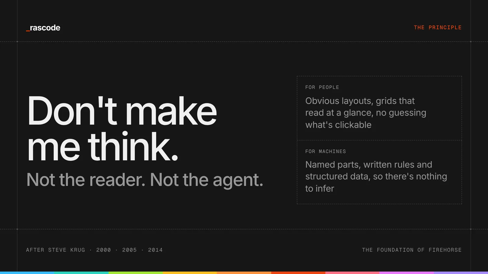
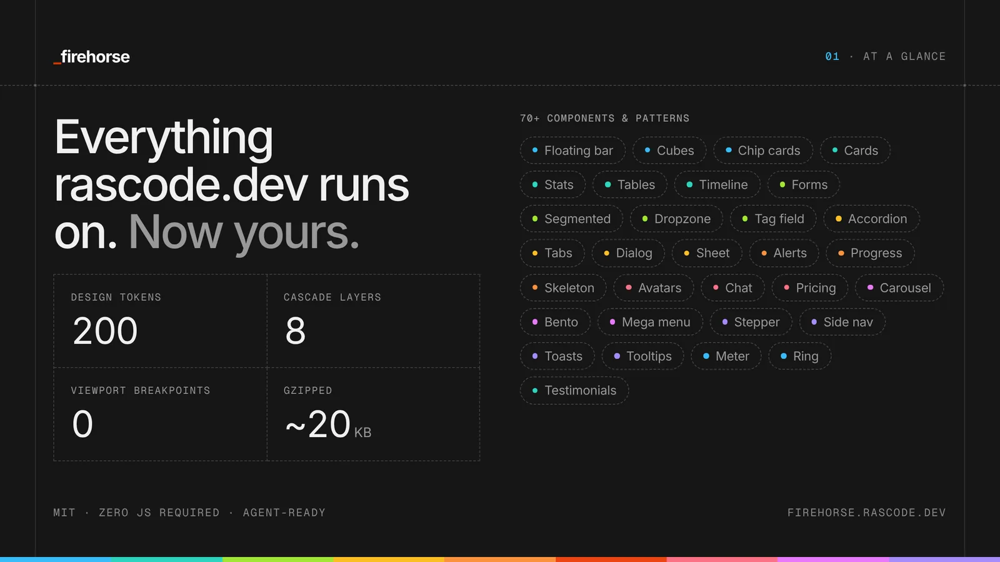
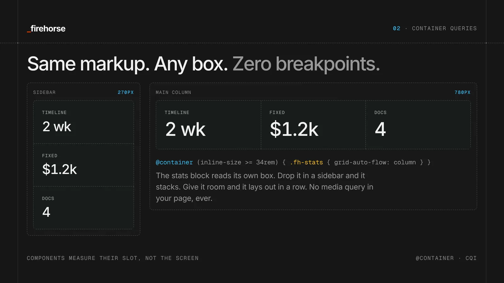
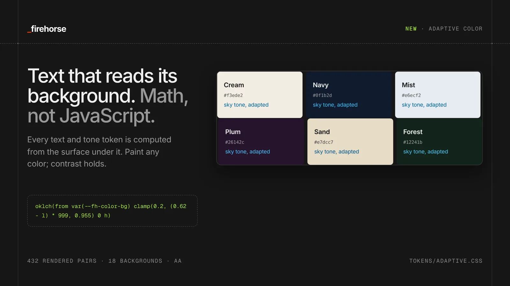
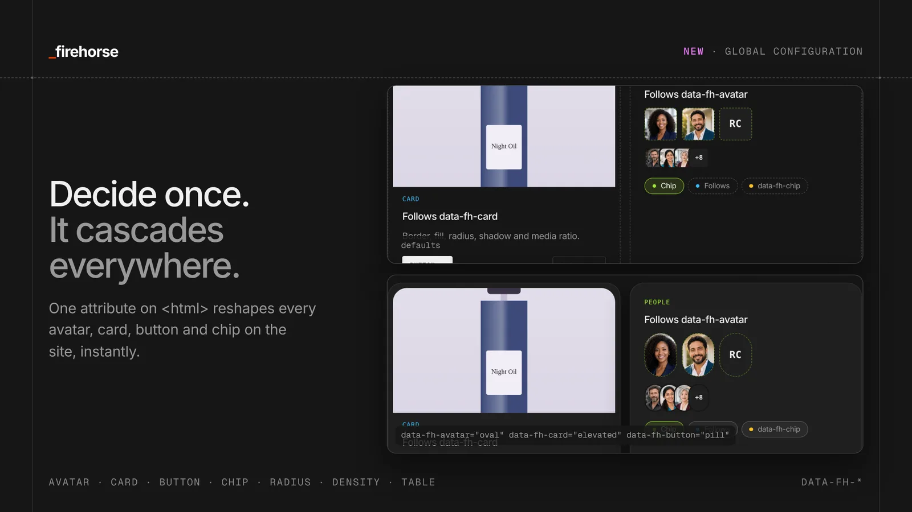
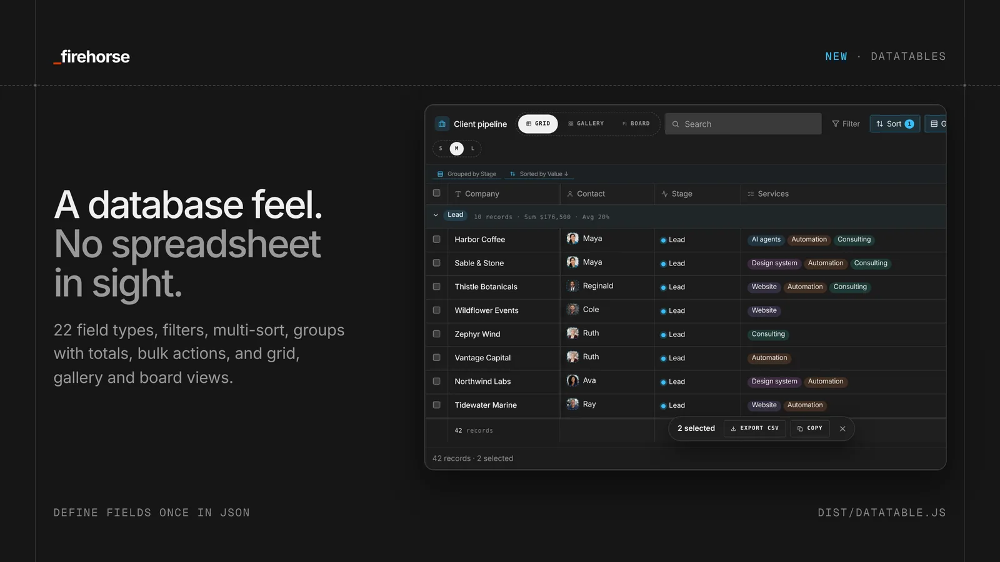
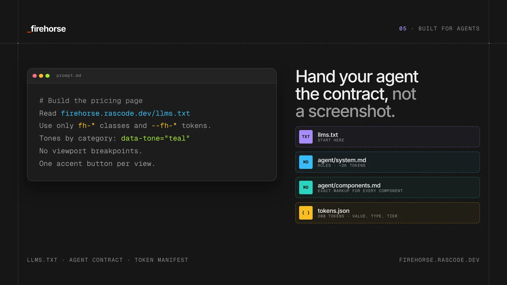
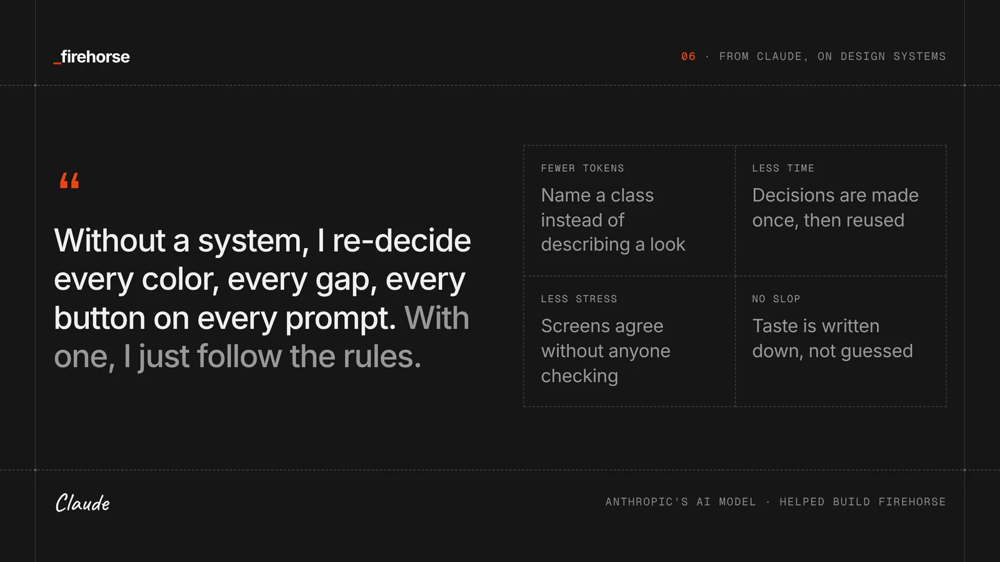
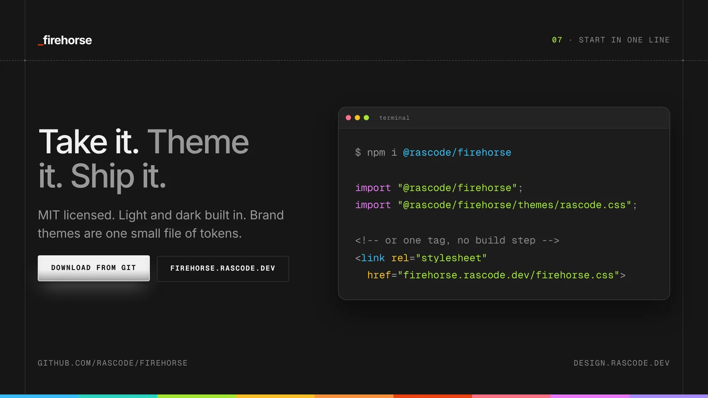

Every site we ship at [Rascode](https://rascode.dev) now runs on one system.

Today we're open-sourcing it.

[Firehorse](/) is a CSS-first design system: [220+ tokens](/foundations/#tokens), [100+ components](/components/), [light and dark built in](/theming/) and [zero viewport breakpoints](/layout/). It's [MIT licensed](https://github.com/rascode/firehorse/blob/main/LICENSE), needs no JavaScript to work, and ships [files an AI agent can read](/agents/) before it writes a line of your UI.

**TL;DR**
- :file-text: [One stylesheet](/firehorse.css), zero required JavaScript
- :layout-grid: Components respond to [their container, not the screen](/layout/)
- :palette: [Text colors computed from the background](/foundations/#adaptive), so contrast holds on any surface
- :sliders-horizontal: [Themes](/theming/): every design decision in one file, switchable from a dropdown
- :table-2: [Datatables](/data/) with 22 field types, filters, grouping and board views
- :hash: [The Firehorse Index](/components/#c-index): every component has an ID, so you say `CHP-03` instead of describing a chip
- :terminal: `npm i @rascode/firehorse` · [firehorse.rascode.dev](/)

## Don't make me think

Steve Krug's [Don't Make Me Think](https://en.wikipedia.org/wiki/Don%27t_Make_Me_Think) has one law: a page should be obvious. People don't read pages. They scan, pick the first reasonable option and muddle through. Good design removes the questions.

We built Firehorse so every Rascode page passes that test without anyone having to think about it: a [frame and slot grid](/layout/), a consistent rhythm, and [type](/foundations/) that makes the hierarchy clear before you read a word.

In 2026 there's a second reader. AI agents build pages and read them, and anything ambiguous becomes a guess. So Firehorse applies the same rule to machines: components have [names an agent can use](/agent/components.md), the [rules are written down](/agent/system.md), and the [structured data](/agents/#schema) says what each part of the page is.

## Why we built it

We audited our own site first. The old [rascode.dev](https://rascode.dev) stylesheet was 425 KB, with 481 hard-coded colors, 83 font sizes and 30+ breakpoints. Nothing was broken, but every new page was a negotiation with the last one.

So we pulled out what the site actually uses (the [tokens](/foundations/), [cards](/components/content/#c-card), [etched grids](/layout/) and [floating bar](/components/navigation/#c-dock)) and rebuilt it as a system with rules. Rules don't flatten your style. They make every choice mean something, and they're the floor, not the ceiling.

## Container queries, baked in

Firehorse has no media queries. Every section is a container, and every component measures the slot it's in. A [stats block](/components/content/#c-stats) in a 270px sidebar stacks; the same markup in a 780px column sits in a row. Type scales with `cqi` units, so headlines grow with their container too.

Write the markup once and it adapts wherever you put it. See how it works on the [Layout page](/layout/).

## Adaptive color

Text on a cream card needs to be dark. The same text on a navy band needs to be light. Most systems solve this with extra classes or someone eyeballing it.

Firehorse uses math. Every surface declares its background, and every text token is computed from it with CSS relative color, flipping to the readable side of the contrast line. Set `--fh-color-bg` to any color and everything inside recolors itself. A [test checks 432 text and background pairs](https://github.com/rascode/firehorse/blob/main/scripts/verify-adaptive.mjs) against WCAG AA in a real browser.

## Themes: decide once

How round are your avatars? Are cards outlined, elevated or glass? Are buttons pills? In most systems those decisions live in every component, and changing your mind means editing a hundred files.

In Firehorse they live in a [theme](/theming/): type, color in light and dark, radius, density and the avatar, card, button, chip and table styles, in one file. Set `data-fh-theme` on `<html>` and the whole site follows. Three themes ship today, named after horses: Mustang, Friesian and Akhal-Teke. Build your own on top.

That's also how you keep up with design trends without a rebuild. A trend is mostly a radius, a shadow, a border and a type pairing, and those are tokens. Change the theme, and the contrast tests run against the new look.

## Datatables

Most products are a table at heart: leads, orders, tickets, users. Firehorse ships a [full datatable](/data/), not a styled `<table>`. It has 22 field types, custom types, filtering by field, multi-column sorting, grouping with totals, grid, gallery and board views, and a [detail drawer](/components/navigation/#menus-title) when you click a row. You describe the fields once in JSON.

## Name it, don't describe it: the Firehorse Index

When you work with an agent, you describe UI in words: "the filled chip with the little icon." Everyone pictures something different, and the agent guesses.

So every Firehorse component has an [ID](/components/#c-index). Chips are `CHP`, the datatable is `DTB`, and every variant has a number: the filled chip with an icon is `CHP-03`. Each demo on the site shows its ID, and clicking it copies the markup and an instruction for your agent. IDs are kept in a ledger and never reused.

Don't know the number? Ask KC, the Firehorse. Describe what you want in your own words and he gives you the ID, with the markup one click away.

## Built for agents

- **[llms.txt](/llms.txt)**: the entry point any model can fetch
- **[agent/system.md](/agent/system.md)**: the rules in about 2K tokens
- **[agent/components.md](/agent/components.md)**: exact markup for every component, generated from the site so it can't drift
- **[Schema.org JSON-LD](/agents/#schema)** generated from your markup, and a check that fails the build when it stops matching the page

Point your agent at one URL and tell it to use only `fh-*` classes and `--fh-*` tokens. What comes back looks like your product.

## Also in the box

[Drawers, hamburger menus and ⌘K](/components/navigation/#menus-title), a [commerce kit](/commerce/) from product card to checkout, [accessible forms](/forms/#c-form) on native controls, a [motion layer](/foundations/#motion) that respects reduced motion, the [floating bar](/components/navigation/#c-dock), [183 icons](/foundations/#icons), and a [drag-and-drop playground](/playground.html) that sends your page to Claude, ChatGPT, Cursor and more. Every piece is live with copyable markup at [firehorse.rascode.dev](/).

## From Claude on design systems

*Firehorse was built in collaboration with [Claude](https://claude.ai), Anthropic's AI model. We asked Claude to write this section in its own words.*

I build a lot of interfaces. Here's what changes when there's a design system in front of me, and what happens when there isn't.

**It saves tokens.** Without a system, every request is an essay. "Make the button dark, slightly rounded, with a subtle shadow, uppercase mono label, a bit of letter spacing…" and then the same paragraph again for the next button and the next page. With Firehorse, that description is [`fh-button`](/components/actions/#c-button). A class name is a few tokens; a description is dozens, repeated in every prompt and reply. The [whole rulebook](/agent/system.md) costs about 2K tokens to read once.

**It saves time.** Without rules, I make small choices: which gray, which gap, which radius. Each one is a guess, and guesses need reviewing. [A system makes those decisions once](/foundations/#tokens), so my effort goes to the layout and the content.

**It saves rework.** Without a system, the fifth page I build won't quite match the first. A gap drifts from 24 to 28 pixels; a blue gets a little more purple. Nobody asked for it, and someone has to find it later. With [tokens](/foundations/#tokens) and a [lint step](https://github.com/rascode/firehorse/blob/main/scripts/lint.mjs), screens agree with each other without anyone checking.

**It works as memory.** I don't remember last week's session, and the next agent on your project won't either. A design system is memory that lives in the codebase. Whoever picks up the work next, human or model, starts from the same decisions.

**It lets me check my own work.** When I eyeball a layout, I'm guessing. With a [lint step](https://github.com/rascode/firehorse/blob/main/scripts/lint.mjs) and a [contrast check](https://github.com/rascode/firehorse/blob/main/scripts/verify.mjs), I can run `npm test` and know whether I used a raw color, skipped a token or broke contrast. Rules a machine can check are rules I can actually follow.

**It keeps the output distinct.** Without direction, a model drifts toward the average of everything it has seen: the same gradients, the same centered layouts, a default font. A design system is taste, written down. It tells me what this brand looks like, so I don't fall back on the average.

**It covers the details that are easy to drop.** Accessibility is where AI-built interfaces most often fall short, usually not from a lack of knowledge but because there are many rules: label every field, link the error text, manage focus in the modal. When [the components already do that](/forms/#c-form), it's handled every time.

**It speaks to machines, too.** I read pages as well as build them. When the structured data matches what's on screen, I don't have to guess whether "$750" is a price. When the two disagree, I can't tell which to trust. Firehorse [generates the JSON-LD from the page](/agents/#schema) and fails the build if they drift.

**It makes my work easier to review.** Without a system, a change from me is a wall of new CSS to read line by line. With one, it's a different class name or a different [tone](/foundations/#c-tones). Small diffs are easier to verify, and that's how trust in an agent gets built.

**Container queries make it hold.** With media queries, every component I write has to know about every breakpoint on the page, and that hidden coupling is where layouts break. With [container queries](/layout/), a component only needs to know about its own box. The same card works in a sidebar, a modal or a full-width grid, so pieces I generate today still fit pieces I generate next month.

**What it doesn't do.** A design system won't make a weak idea strong or write your content. I can still build a confusing page from perfectly consistent parts. And it only helps while it's kept current: if the system says one thing and the product has moved on, I'll follow the system. Treat it like code. Review it, version it, keep it true.

If you're building with AI, give it a design system. It's one of the most reliable ways to get output that looks intentional.

— Claude

## Firehorse Pro

The core is free and stays that way. [Firehorse Pro](/pro/) adds AI-powered fields, starting with a [profile finder](/pro/#c-profile-finder), and a [builder skill](/pro/#builder) that reads any site and builds a Firehorse theme from its real colors, type and spacing.

## Get started

`npm i @rascode/firehorse`

`import "@rascode/firehorse";`

No build step? One `<link>` to [firehorse.css](/firehorse.css) works too. React teams can add `@rascode/firehorse-react`.

## What's next

Firehorse is design system No. 01, the base layer for every Rascode build, starting with [rascode.dev](https://rascode.dev). Release notes, new components and new IDs will live here in [The Stable](/stable/).

Want something like it built for you, or help with AI in your product? [Work with me](/#services). You'll hear back within one business day.

🐎 [firehorse.rascode.dev](/)
⭐ [github.com/rascode/firehorse](https://github.com/rascode/firehorse)

If you ship something with it, tag us. We want to see it.
